# The Good Wren (Formerly "Food Finder") - Food Assistance Locator Prototype
The Good Wren is intended to be an Arizona-based interactive map-first food assistance locator designed to help users find the resources they may be looking for. 

## Live Site/APP
- [The Good Wren](https://the-good-wren-prototype.vercel.app/)
- `https://the-good-wren-prototype.vercel.app/`

## Conceptualization

### Moodboard
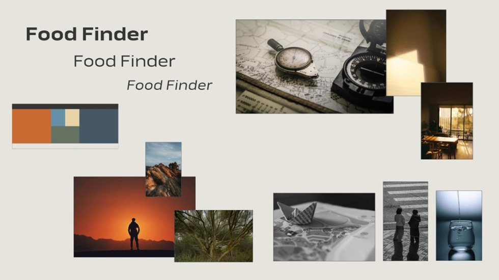

### Wireframes

#### Desktop
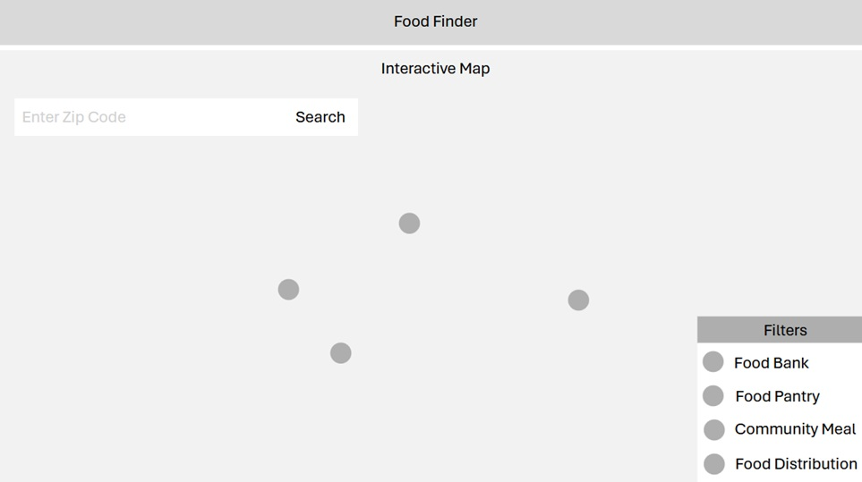
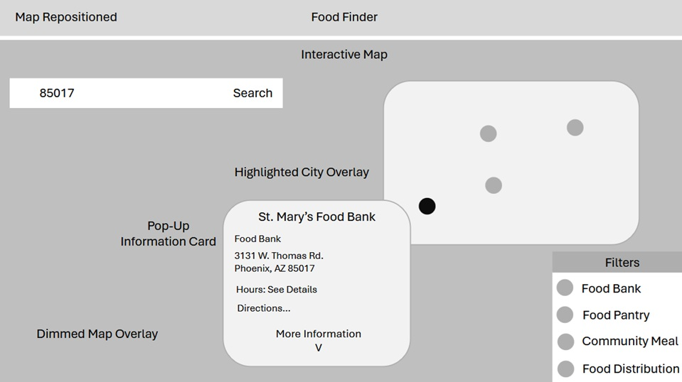

#### Tablet
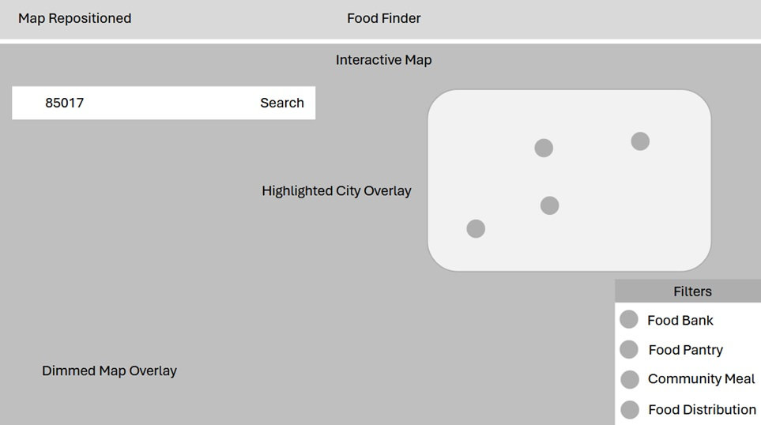

#### Mobile
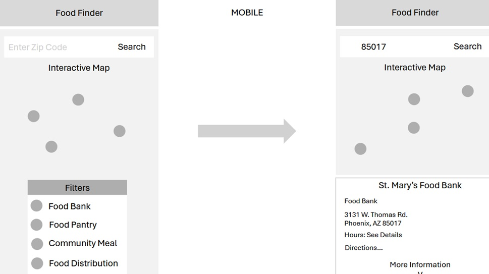

## Prototype Flow
- Users search AZ ZIP Code, explore matching resources on the map, select a resource marker, review its information card.
- Resource data remains temporary and hardcoded for prototype development
- Dynamic resource retrieval has not been implemented yet
- Search area results temporarily approximated to 5km radius of ZIP Codes

## Sept. 20th - 27th, 2026

### Data Array
- Copied over PoC code to adjust
- Added JavaScript data structure for multiple resources
- Added dynamic generation of resource markers
- Added temp, unconfirmed, resources (for testing)
- Added data fields to cards

### UI & Layout

#### Location Search
- Added ZIP Code search form
- Added 5-digit ZIP Code validation
- Added [Nominatim](https://nominatim.openstreetmap.org/) geocoding for ZIP searches
- Added map repositioning based on returned coordinates
- Added AZ-specific location validation
- Added geocoding validation and error handling
- Added marker toggling for searched ZIP Code results
- Added visual search area circle
- Added animated map repositioning via Leaflet ```flyTo```
- Added map dimming/spotlight effect around ZIP Code location circle
- Retouched search-area visualization (will style later)
- Ensured resource markers remain visible when map is dimmed

#### Resource Markers & Cards
- Added dynamic marker generation from resource array
- Added marker popups
- Added resource name & location
- Added resource address & service
- Added hours, contact, & availability fields
- Added expandable "More Information" toggle with HTML ```<details>``` and ```<summary>``` elements
- Added resource type & additional info to expandable section
- Added "Placeholder" text to resource fields pending later verification

#### Resource Filtering
- Added JavaScript filters by resource type
- Combined ZIP Code and resource filtering so markers match both conditions where applicable
- Added temp resources (placeholders) to test/verify filtering behavior within 85017
- Added filter focus handling

#### Stylization
- Compacted header section to maintain map-dominance
- Styled temp logo & ZIP Code search according to covnention
- Relocated Resource Filtering and Messaging as a floating overlay
- Integrated Messaging into Filter panel
- Added responsive styling for smaller screens
- Added and explored automatic map panning to improve popup card visibility (will need to return to this in future developement)

### Results

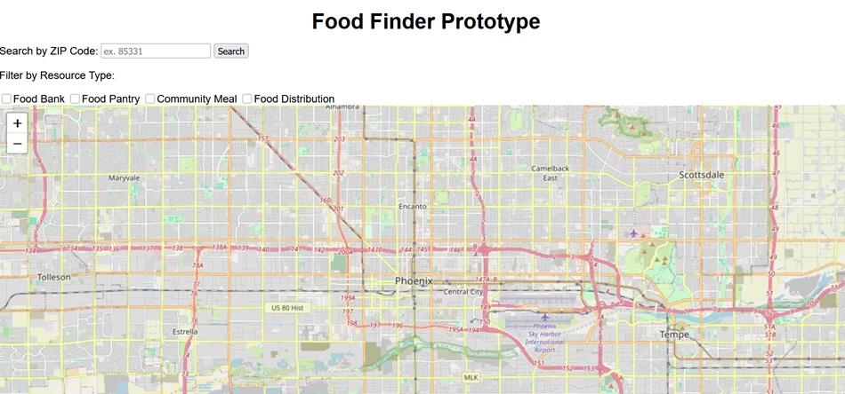
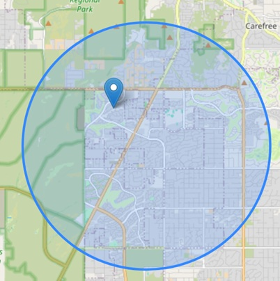
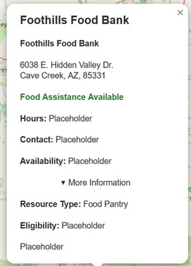

## Oct. 4th - 18th, 2026

### Database & Seed Data
- Compliled [AZ Governor's food-pantry directory](https://azgovernor.gov/food-pantry-resources-for-arizonans) data into a CSV with Excel
- CSV fields incluce: county, city, name, type, address, website, and phone
- Created new MongoDB Atlas database: goodWrenDB and collection: foodResources
- Imported 202 resource documents (from AZ Governor's) into MongoDB

### Backend
- Initialized `Node.js` with `package.json`
- Installed Express, MongdoDB Node.js, driver and dotenv
- Created `server.js` for Express API
- Configured env's in `.env` file
- Added .env to `.gitignore`
- Connected Express backend to MongoDB Atlas
- Configured database access to `goodWrenDB.foodResources`
- Added GET /api/health endpoint to verify backend
- Added GET /api/resources endpoint to retrive resource documents as JSON
- Verified successful database connection and API responses (locally)
- Used [U.S. Census Geocoder](https://geocoding.geo.census.gov/geocoder/) to match resource addresses to coordinates
- Generated `resource-coordinates.json` with 102 exact-match coordinate pairs out of 202 documents; remaining records not included due to lack of exact matches
- Updated GET /api/resources to return only approved coordinates, attached lat. and lon. to API responses
- Confirmed API responses contain only matches resources/coordinates leaving the database unchanged

### Frontend
- Deleted temp. resources
- Connected to GET /api/resources to load the real resources and display map markers
- Updated marker filtering to display resources within 5km of searched location
- Added `Clear Search` button to remove active search radias and overlay, restore markers, and preserve current map position with selected filters
- Updated filters to database type descriptions
- Updated map to display all markers on load-up and after clearing search (depending on filter selection)
- Tested functionality and flow

### Deployment
- Deployed successfully to Vercel

### Results

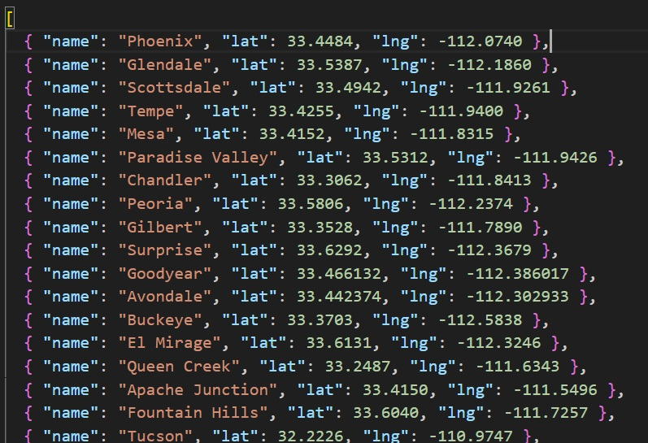
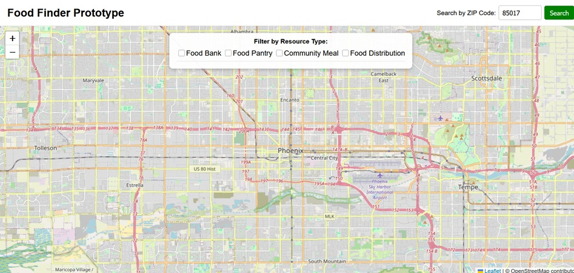
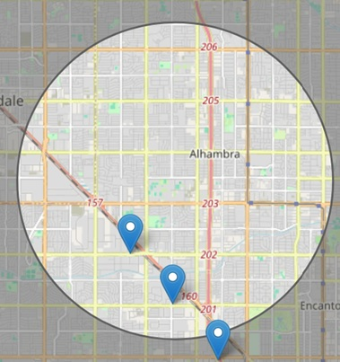


## Oct. 26th - Nov. 1st, 2026

### Style Guide

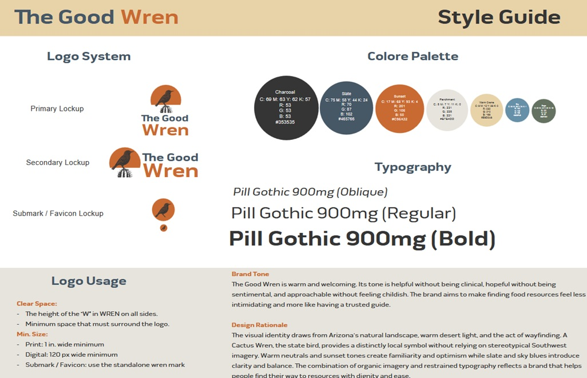

### Mockups

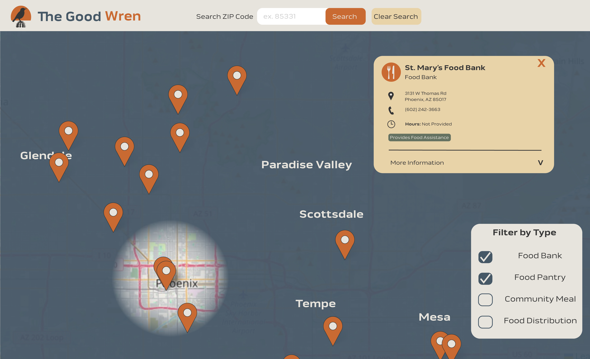
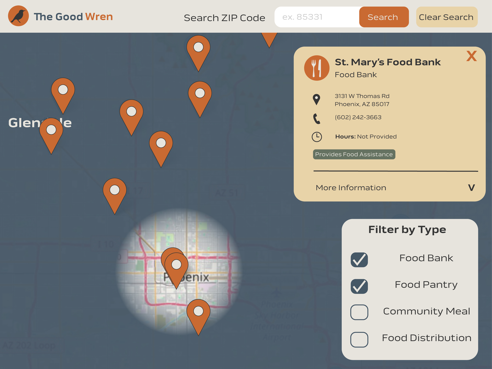
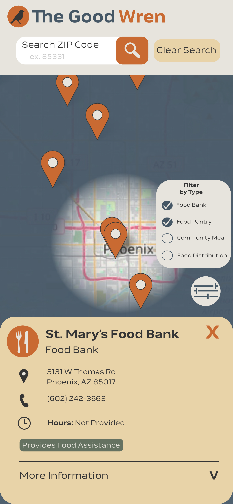

### Logo Design


### Visual Design and CSS Organization

Introduced CSS custom properties for the application's visual identity:
  - Charcoal: `#353535`
  - Slate blue: `#465766`
  - Sunset orange: `#c96a32`
  - Parchment: `#e7e4dd`
  - Warm cream: `#e8d2a8`
  - Sky blue: `#668fa8`
  - Sage green: `#657261`
- Refined the compact header and ZIP-code search controls.
- Added responsive CSS adjustments for narrower viewports.

### Map and Resource Markers

- Implemented custom sunset-colored resource markers using Leaflet `divIcon` elements.
- Added a slate-blue map dimming overlay.
- Added custom geographic labels to reinforce the map-first design.
- Developed a radial spotlight effect intended to highlight selected resources and ZIP-code search locations.
- Connected spotlight positioning to map movement and zoom events.
- Investigated Leaflet pane stacking and positioning conflicts affecting marker visibility.

### Resource Information Cards

- Replaced marker-attached popups with a separate resource information card.
- Positioned the card in the upper-right area of the map.
- Added a close control.
- Organized essential resource details into a clearer visual hierarchy.
- Retained expandable secondary information.
- Connected marker selection to resource-card display and map repositioning.

### Resource Filters and Search

- Repositioned the resource-type filter panel to the lower-right corner.
- Organized filter options into two columns.
- Retained combined ZIP-code and resource-type filtering.
- Preserved the five-kilometer ZIP-code search radius.
- Retained search validation, clear-search functionality, and user-facing status messages.

### Troubleshooting

- Corrected mismatched HTML element identifiers and missing interface elements.
- Resolved JavaScript errors affecting city-label generation, resource-card controls, and distance calculations.
- Corrected spotlight radius calculations.
- Investigated CSS stacking contexts and Leaflet's internal map panes.
- Verified the primary map, marker-selection, search, and filtering interactions during local testing.

### Logo & Favicon

- Created assets folder
- Added images and updated index.html and styles.css

## Nov. 2nd - Nov. 3rd, 2026

### Troubleshooting

- Corrected dimmed markers, they now remain visible above the map overlay and geographically anchored during panning and zooming.
- Improved spotlight positioning, radius scaling, and smooth zoom animations while preserving feathered edges.
- Changed the map overlay to solid slate blue to reduce visual clutter.
- Expanded Arizona city labels and moved their coordinates into a separate JSON file for easier maintenance.
- Adjusted city-label positioning (Goodyear & Avondale) to reduce overlap and improve alignment.
- Added a minimum zoom level to prevent excessive zooming out and marker crowding.
- Consolidated frontend files into `/public`, eliminating duplicate files between local development and Vercel deployment.

## Nov. 4th, 2026 - Nov. 7th, 2026

### Assignment Adjustment

- Added a meta description tag for SEO / improve Chrome Lighthouse rating.

### Mobile Adjustments

- Centered logo lockup
- Reduce header size
- Relocated ZIP search, search button, clear search button outside of header
- Changed "Clear Search" to "Clear" to reduce obviousness and redundancy
- Relocated to lower right viewport
- Made collapsable w/icon at mobile resolution
- Removed clear spotlight when filtering to maintain user focus
- Opted to keep search message as-is now that filtering has been relocated
- Moved info card to bottom of viewport, persist until cleared, new marker selected, new search
- Attribution placement adjusted for relocated info card and filtering
- Increased auto zoom upon marker selection to maintain user focus

## Nov. 10th, 2026 - Nov. 11th, 2026

### Intro Modal & Typography

- Added responsive intro modal with a welcome message and usage instructions
- Added a **Click to Begin** CTA button, with backdrop-click and Escape-key closure
- Implemented keyboard focus management and background interaction restrictions while modal is open
- Added Adobe Fonts to display **Pill Gothic 900mg** throughout the application
- Refined intro text formatting with responsive line breaks for desktop and mobile
- Added mobile styling adjustments for smaller screens, including 320px viewports
- Updated **How To** instructions with clearer **or** and **then** transitions
- Left-aligned usage instructions and added sunset-colored bullets

## Final Prototype

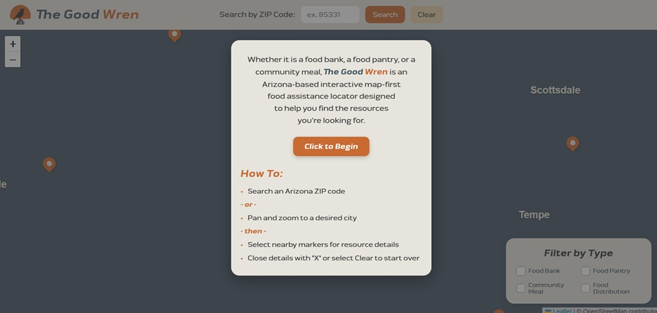
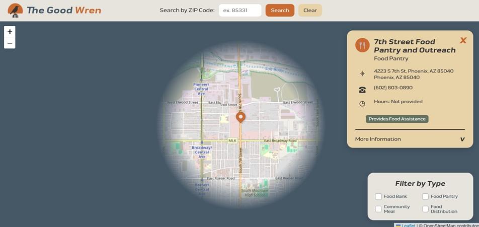
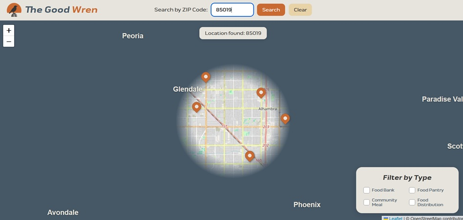
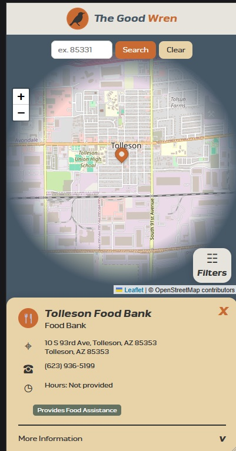